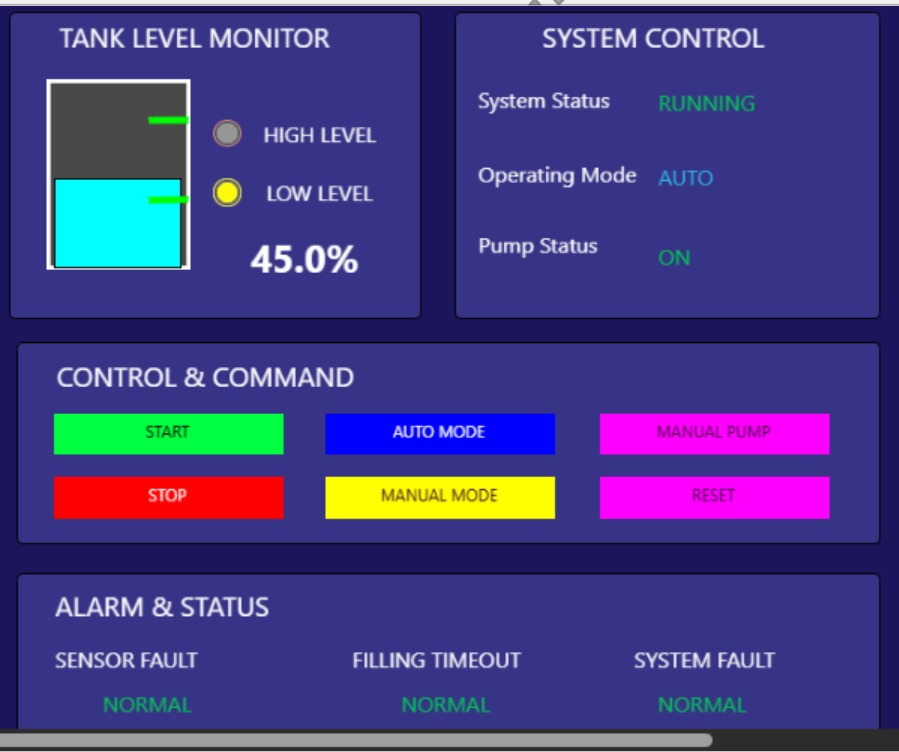
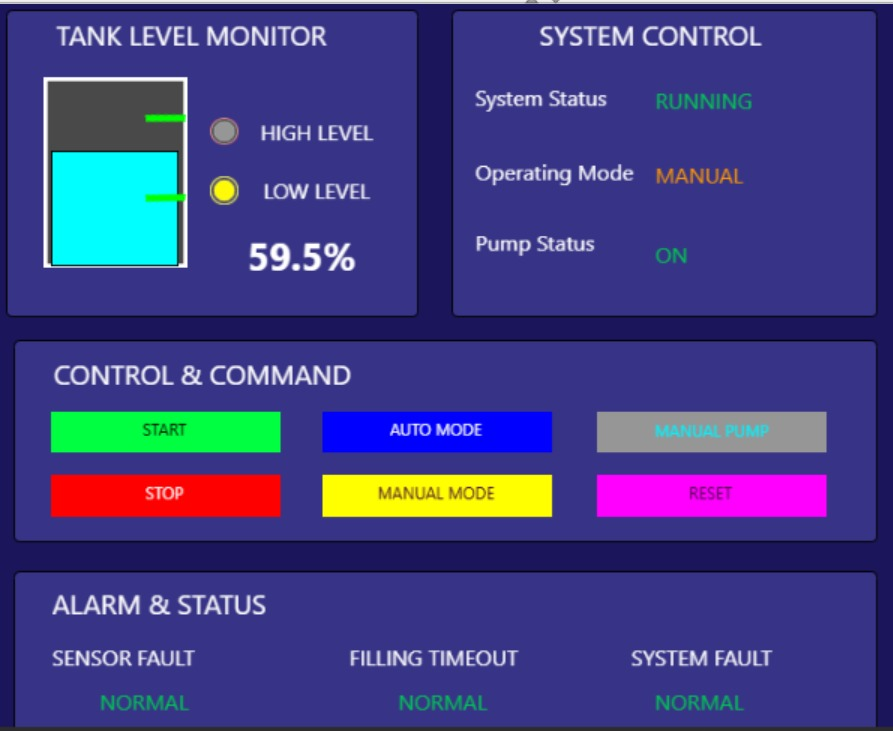

# Automatic Water Tank Level Control System

**PLC Automation Portfolio Project · CODESYS · Ladder Diagram**

A PLC-based water tank level control simulation featuring Automatic and
Manual operating modes, pump control, level monitoring, High Level
interlock protection, and HMI visualization.

------------------------------------------------------------------------

## Project at a Glance

  Item                   Description
  ---------------------- ----------------------------------------------
  Project                Automatic Water Tank Level Control System
  Project level          Intermediate
  Development software   CODESYS Development System V3.5 SP22 Patch 4
  Runtime                CODESYS Control Win V3 x64
  Main language          Ladder Diagram (LD)
  HMI                    CODESYS Visualization
  Project type           Software simulation

## Overview

This project simulates an automated water-filling application controlled
by a PLC. Two digital level conditions---Low Level and High Level---are
used to control the filling cycle.

In **Automatic Mode**, the PLC requests pump operation when the Low
Level condition is detected and stops the pump when the High Level
condition is reached.

In **Manual Mode**, the operator can command the pump through the HMI.
High Level interlock protection remains active.

The project was developed to demonstrate PLC control logic, operating
mode handling, interlocking, HMI development, and functional testing
using CODESYS.

## HMI Preview

Add the project screenshots to the repository using the filenames shown
below. GitHub will display the images when the paths match the
repository structure.

### Automatic Mode



### Manual Mode



## Main Features

-   **Automatic Mode:** Level-based pump control using Low Level and
    High Level conditions.
-   **Manual Mode:** Operator pump ON/OFF commands through the HMI.
-   **Start/Stop Control:** System enable and stop commands.
-   **Level Monitoring:** Tank-level visualization and sensor status
    indication.
-   **Pump Monitoring:** Running/Stopped status indication.
-   **High Level Interlock:** Stops pump operation when the High Level
    condition is detected, including during Manual Mode.
-   **Alarm interface:** Alarm/system status indication and reset
    interface; filling timeout behavior remains unverified.

## Simplified System Architecture

``` text
 Low Level Sensor       High Level Sensor
         \                    /
          \                  /
           v                v
       +------------------------+
       |      PLC CONTROL       |
       |                        |
       |  - Start / Stop        |
       |  - Auto / Manual       |
       |  - Pump Control        |
       |  - High Level Interlock|
       |  - Alarm-related Logic |
       +-----------+------------+
                   |
                   v
             +-----------+
             | Water Pump|
             | (Simulated)|
             +-----------+

       HMI <----> PLC Status / Commands
```

## Operating Sequences

### Automatic Mode

1.  Start the system and select Automatic Mode.
2.  The PLC monitors the level conditions.
3.  Low Level detection requests pump operation.
4.  The pump fills the tank.
5.  High Level detection stops the pump.
6.  The system returns to level monitoring.

### Manual Mode

1.  Start the system and select Manual Mode.
2.  Issue a pump ON command through the HMI.
3.  The PLC evaluates the command and protection conditions.
4.  The pump operates when permitted.
5.  The pump stops on a manual OFF command or High Level interlock.

## Functional Test Results

  Test scenario                     Result
  --------------------------------- ----------------
  Automatic Filling Operation       **PASS**
  Manual Pump Operation             **PASS**
  High Level Interlock Protection   **PASS**
  System Stop and Restart           **PASS**
  Sensor Fault Injection            **NOT TESTED**
  Filling Timeout Alarm             **NOT TESTED**

**Build verification:** 0 errors · 0 warnings

The results above represent software simulation testing only. No
physical PLC hardware or field equipment testing was performed.

## Documentation

-   [Project Overview](01_Project_Documentation/Project_Overview.md)
-   [System
    Architecture](01_Project_Documentation/System_Architecture.md)

## Scope and Limitations

This is an educational and portfolio-oriented software simulation of a
single water tank with two digital level conditions. It does not include
a physical PLC, pump, or field-installed sensors.

Sensor fault injection and filling timeout alarm behavior were not
verified in the completed functional tests. The simulated interlock is a
control demonstration and is not a substitute for a certified physical
safety system.

## Skills Demonstrated

-   PLC Programming with Ladder Diagram
-   Digital input and output concepts
-   Automatic and Manual control logic
-   Latching logic and timer application
-   Interlock and protection logic
-   HMI development with CODESYS Visualization
-   PLC software simulation
-   Functional testing and technical documentation

------------------------------------------------------------------------

**Project status:** Completed software simulation; selected functions
remain unverified as noted above.\
**Category:** Industrial Automation · PLC Programming · HMI Development
